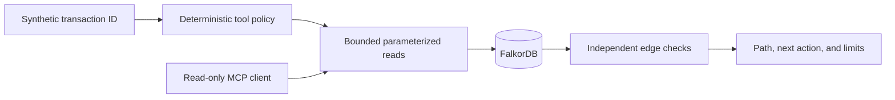

# Vesper

**Vesper is a six-agent workspace that turns a synthetic transaction ID into a bounded, evidence-checked graph investigation.**


Vesper helps analysts follow directed connections without hiding the proof. It reads a local FalkorDB graph, checks every accepted edge again, rejects disconnected leads, and returns the next investigative action. This repository is the **Graph Hacks Track 1** submission and uses generated synthetic data only.

> Vesper produces investigative leads, not legal conclusions about any person.

## Install and run

You need Python 3.12, [Node 24.1.0](.nvmrc), Docker Desktop, and Git.

```sh
git clone --branch track1-submission --single-branch https://github.com/Meet547/Vesper.git
cd Vesper

python3.12 -m venv .venv
.venv/bin/python -m pip install -r requirements-track1-lock.txt

export VESPER_REPO="$PWD"
export VESPER_RUN_DIR="$(mktemp -d)"
cd "$VESPER_RUN_DIR"
PYTHONPATH="$VESPER_REPO" "$VESPER_REPO/.venv/bin/python" "$VESPER_REPO/scripts/track1_container.py" create

cd "$VESPER_REPO"
export VESPER_TRACK=track1_synthetic
export VESPER_TRACK1_GRAPH=vesper_synthetic_verify
export VESPER_TRACK1_TARGET_FILE="$VESPER_RUN_DIR/evidence/track1/isolation-target.json"
.venv/bin/python -m scripts.load_track1_graph
.venv/bin/python -m uvicorn backend.track1.app:create_app --factory --host 127.0.0.1 --port 18783
```

Open [http://127.0.0.1:18783](http://127.0.0.1:18783). No cloud account or `.env` file is required.

Quick API check:

```sh
curl --fail-with-body --silent --show-error \
  -H 'Content-Type: application/json' \
  -d '{"start_txid":"SYN-000001","end_txid":"SYN-000004","max_hops":3}' \
  http://127.0.0.1:18783/api/route
```

Expected path:

```text
SYN-000001 → SYN-000002 → SYN-000003 → SYN-000004
```

## The investigation team

| Agent | Task |
| --- | --- |
| **Scout** | Finds the seed transaction and checks its source context. |
| **Tracer** | Follows bounded, directed graph paths. |
| **Analyst** | Interprets only the evidence that passed validation. |
| **Skeptic** | Rechecks every transaction and directed edge independently. |
| **Historian** | Organizes graph-linked case context. |
| **Reporter** | Produces the evidence-first result and its limitations. |

## How it works



The graph model is intentionally small:

- `(:Transaction {txId, label, timeStep, sourceDataset})`
- `(:Transaction)-[:FLOWS_TO]->(:Transaction)`
- 4,000 generated nodes and 6,685 generated directed edges
- six-hop maximum, two-second read deadline, and no fixture fallback

The MCP server exposes three bounded, read-only tools: `get_transaction`, `expand_outgoing`, and `shortest_path`. Tool selection is deterministic; this submission does not claim LLM-driven tool selection.

## Try these questions

| Question | Expected result |
| --- | --- |
| What is the three-hop lead from `SYN-000001`? | `SYN-000001 → SYN-000002 → SYN-000003 → SYN-000004` |
| What is the three-hop lead from `SYN-000007`? | `SYN-000007 → SYN-000008 → SYN-000009 → SYN-000010` |
| Does the decoy connect `SYN-000006` to `SYN-000004`? | No. The independent edge query returns zero rows. |
| What changes when `SYN-000002 → SYN-000003` is removed from the counterfactual graph? | The action changes from `inspect_endpoint` to `request_additional_evidence`. |

## Test it

```sh
.venv/bin/python -m pytest -q
node --test tests/*.test.mjs
```

Saved clean-clone results: **91 Python tests passed**, **37 frontend tests passed**, the database readback reported **zero writes**, and the HTTP path matched the manifest hop for hop. See [`evidence/track1/delivery.json`](evidence/track1/delivery.json).

## Data, AI use, and limits

- `scripts/generate_synthetic_graph.py` creates every submitted graph record with seed `20261018`.
- The dataset contains invented IDs and neutral roles—no real Bitcoin transactions, wallet addresses, or personal data.
- Unit-test fixtures are mocked test inputs, not database evidence.
- OpenAI Codex assisted with the generator, adapter, tests, interface, documentation, and README hero artwork.
- The office prototype and character sprite pack are reused presentation assets with repository-recorded dates documented in [`docs/ELIGIBILITY.md`](docs/ELIGIBILITY.md).
- The full evidence index is [`evidence/track1/REPORT.md`](evidence/track1/REPORT.md), and the three-minute demo is [`docs/demo-storyboard.md`](docs/demo-storyboard.md).

## Cypher catalog

All values are passed as parameters. Runtime tools use read-only graph queries; setup writes are isolated to a new allowlisted graph, and the counterfactual deletion is isolated to `vesper_counterfactual`.

<details>
<summary>Show every query</summary>

```cypher
RETURN 1 AS ready
```

```cypher
MATCH (t:Transaction {txId: $tx_id})
RETURN t.txId, t.label, t.timeStep, t.sourceDataset
LIMIT 2
```

```cypher
MATCH (n)
RETURN labels(n) AS label, count(*) AS nodes
ORDER BY label
```

```cypher
MATCH ()-[r]->()
RETURN type(r) AS rel, count(*) AS edges
ORDER BY rel
```

```cypher
MATCH (t:Transaction)
RETURN t.label AS role, count(*) AS nodes
ORDER BY role
```

```cypher
MATCH p=(s:Transaction {txId: $start_txid})-[:FLOWS_TO*1..6]->(t:Transaction)
WHERE length(p) <= $max_hops
RETURN [n IN nodes(p) | n.txId] AS txids,
       [r IN relationships(p) | id(r)] AS relationship_ids,
       length(p) AS hops
ORDER BY hops DESC, txids ASC
LIMIT 41
```

```cypher
MATCH (s:Transaction {txId: $source})-[r:FLOWS_TO]->(t:Transaction {txId: $target})
RETURN id(r) AS relationship_id
LIMIT 2
```

```cypher
MATCH (t:Transaction)
RETURN t.txId, t.label, t.timeStep, t.sourceDataset
ORDER BY t.txId
```

```cypher
MATCH (s:Transaction)-[r:FLOWS_TO]->(t:Transaction)
RETURN s.txId, t.txId, id(r)
ORDER BY s.txId, t.txId
```

```cypher
MATCH (s:Transaction {txId: $start_txid}), (t:Transaction {txId: $end_txid})
WITH shortestPath((s)-[:FLOWS_TO*1..6]->(t)) AS p
WHERE p IS NOT NULL AND length(p) <= $max_hops
RETURN [n IN nodes(p) | n.txId],
       [r IN relationships(p) | id(r)],
       length(p)
```

```cypher
MATCH (n)
RETURN n.txId, labels(n), keys(n)
ORDER BY n.txId
```

```cypher
MATCH ()-[r]->()
RETURN DISTINCT keys(r)
```

```cypher
UNWIND $nodes AS tx
CREATE (t:Transaction {
  txId: tx.txId,
  label: tx.label,
  timeStep: tx.timeStep,
  sourceDataset: tx.sourceDataset
})
RETURN count(t)
```

```cypher
UNWIND $edges AS edge
MATCH (s:Transaction {txId: edge.source}), (t:Transaction {txId: edge.target})
CREATE (s)-[r:FLOWS_TO]->(t)
RETURN count(r)
```

```cypher
MATCH (s:Transaction {txId: $source})-[r:FLOWS_TO]->(t:Transaction {txId: $target})
DELETE r
RETURN count(r) AS removed
```

</details>

Readable query notes are in [`docs/TRACK1_QUERIES.md`](docs/TRACK1_QUERIES.md).

## License

Apache License 2.0. See [`LICENSE`](LICENSE).
