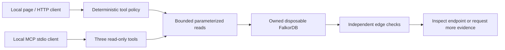

# Vesper — synthetic Track 1 adapter

Vesper helps an analyst inspect directed connections, reject a disconnected lead, and change the next action when the graph changes. This branch demonstrates **Track 1 only** through a separate, explicitly selected adapter. Findings are investigative leads, not legal conclusions about any person.

Local results are in [the release report](evidence/track1/REPORT.md). Publication and submission have not been performed. Originality still requires the team's written evidence or an organizer answer; the team reports no organizer answer. Track 2 live status: **NOT TESTED TODAY**. Existing Track 2 code, tests, fixtures, validators and owner-scoped memory behavior are preserved.

## Data and architecture

Seed data is generated by `scripts/generate_synthetic_graph.py` with seed **20261018**, generator version **1.0.0**. It contains no real transactions, addresses, or personal data. The labels are neutral scenario tags.

The independently authored dataset has **4,000 Transaction nodes and 6,685 FLOWS_TO edges**. Properties are `txId` (string, `SYN-` and six digits), `label` (`hub`, `relay`, or `endpoint`), `timeStep` (integer), and `sourceDataset` (string). Relationships have no properties. [The manifest](manifest/synthetic_manifest.json) lists expected paths, derived edge references, counts, seed, version, and hashes. Native relationship IDs are captured separately and are not portable identifiers.



The adapter imports no legacy graph store, model agent, memory store, or demo fixture. Selection is a deterministic policy, not an LLM reasoning claim. A destination selects `shortest_path`; a seed investigation selects lookup and bounded expansion. Database errors discard partial evidence. Queries have two-second deadlines, traversal is limited to six hops, and expansion returns at most 40 paths with a truncation flag. There is no fixture fallback.

Every supported Cypher statement, including setup-only writes, is in [TRACK1_QUERIES.md](docs/TRACK1_QUERIES.md). Configuration and provenance are in [TRACK1_ADAPTER.md](docs/TRACK1_ADAPTER.md).

## Clean-clone local setup

Prerequisites: a working Python 3.12, Node.js for existing frontend tests, Docker Desktop, and the local FalkorDB image. No Cloud account or `.env` file is used. This branch is local only. The clean-clone check uses the commit recorded in its evidence.

```sh
git clone --no-hardlinks /private/tmp/vesper-track1-20261018 /private/tmp/vesper-track1-clean
cd /private/tmp/vesper-track1-clean
python3.12 -m venv .venv
.venv/bin/python -m pip install -r requirements-track1-lock.txt
.venv/bin/python -m scripts.generate_synthetic_graph --output /private/tmp/vesper-generated-check
export VESPER_TRACK=track1_synthetic
export VESPER_TRACK1_GRAPH=vesper_synthetic_verify
```

On the audit machine, Homebrew Python's platform metadata was broken. The clean-clone check uses this working Python 3.12 executable for the venv step:

```sh
/Users/meetpardeshi/.cache/codex-runtimes/codex-primary-runtime/dependencies/python/bin/python3.12 -m venv .venv
```

On the **audit machine**, reuse the already-created container's identity record, then perform an exact readback. Do not run `create` again:

```sh
export VESPER_TRACK1_TARGET_FILE=/private/tmp/vesper-track1-20261018/evidence/track1/isolation-target.json
.venv/bin/python -m scripts.load_track1_graph
```

On a **fresh machine**, creation requires no existing `vesper-verify` container and a locally available `falkordb/falkordb:latest` image. It records the resolved image digest. Create from an empty scratch directory so cloned historical evidence cannot authorize a different server. Initial provisioning was exercised during this run; the clean clone reuses that same authorized container.

```sh
mkdir -p /private/tmp/vesper-fresh-run
cd /private/tmp/vesper-fresh-run
PYTHONPATH=/private/tmp/vesper-track1-clean /private/tmp/vesper-track1-clean/.venv/bin/python /private/tmp/vesper-track1-clean/scripts/track1_container.py create
cd /private/tmp/vesper-track1-clean
export VESPER_TRACK1_TARGET_FILE=/private/tmp/vesper-fresh-run/evidence/track1/isolation-target.json
.venv/bin/python -m scripts.load_track1_graph
```

Run the separate Track 1 application:

```sh
.venv/bin/python -m uvicorn backend.track1.app:create_app --factory --host 127.0.0.1 --port 18783
```

Open <http://127.0.0.1:18783/>. No external art, fonts, or scripts are loaded. The historical office frontend is preserved and is not this adapter's entry point.

## Demo and checks

Read sample IDs and expected results from the manifest:

```sh
.venv/bin/python - <<'PY'
import json
m = json.load(open('manifest/synthetic_manifest.json'))
for s in m['scenarios']:
    print('Investigate', s['start_txid'], 'at 3 hops:', ' -> '.join(s['expected_path']))
    print('Shortest route to', s['end_txid'], 'has 3 hops')
PY
```

Scenario 1 returns `SYN-000001 → SYN-000002 → SYN-000003 → SYN-000004`; scenario 2 returns `SYN-000007 → SYN-000008 → SYN-000009 → SYN-000010`. Both select `inspect_endpoint`. A missing decoy connection is rejected by a zero-row edge query. In `vesper_counterfactual` only, removing the manifest edge changes the first action to `request_additional_evidence`; the other scenarios remain intact.

`POST /api/route` accepts `start_txid`, `end_txid`, and required `max_hops` from 1 to 6. The MCP server exposes only `get_transaction`, `expand_outgoing`, and `shortest_path`, using official Python SDK 1.30.0 over stdio. Run `.venv/bin/python -m backend.track1.mcp_server` with the same explicit environment. [The demo script](docs/judge-walkthrough.md) uses only saved live results.

```sh
.venv/bin/python -m pytest -q
node --test tests/*.test.mjs
```

Live verification scripts intentionally stop/restart **only the recorded owned container**. Run them from the original audit checkout where the current identity record lives. `verify_track1_gates 2` is a one-time counterfactual setup and deletion; do not rerun after deletion. Use `verify_track1_final` for read-only counterfactual rechecks. Gate 3 timeout induction tries at most 20 real one-millisecond requests; fast successful requests are retained, and lack of an actual timeout is not a pass.

## Provenance, AI use and retained history

The new generator, adapter, tests and plain HTML interface were authored for this run with OpenAI Codex assistance. The dataset uses no third-party input. Team authorization covers this synthetic project data; ownership agreement between team members remains a team responsibility. No third-party assets were introduced. Dependencies retain upstream licenses: MCP is MIT and NetworkX is BSD-3-Clause. See [dependency evidence](evidence/track1/dependency-provenance.json).

All records and role labels are invented. Unit-test fixtures are **synthetic demo fixture, not database evidence**. Historical fixtures, dataset references and prior README content remain in Git history; preserved Track 2 fixtures are not loaded by this adapter. See [the inventory](evidence/dataset_references.md) and [the original contract](evidence/contract_before.md). Global transaction validation remains numeric-only; `SYN-` acceptance is confined to `backend/track1`.

The team must review and be able to explain the code, graph model, queries and AI assistance before submission. No public branch, release, or submission was changed by this isolated run.
