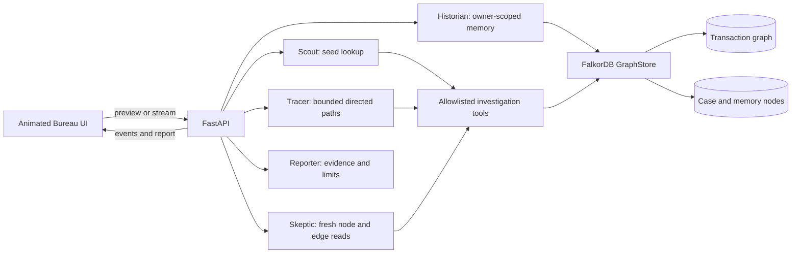

# BUREAU architecture

## Data flow

The browser displays backend results and streamed stage/handoff events. It does not choose investigation actions or manufacture graph evidence. In the explicitly isolated Track 2 mode, the backend binds to loopback and uses the separately named synthetic graph `vesper_track2_synthetic_test`; the previous `bureau_m84_isolated_test` graph is not selected or modified. Its seed namespace is `bureau_synthetic_v1`.

## Graph model

- `(:Transaction {txId, label, timeStep, sourceDataset})`
- `(:Transaction)-[:FLOWS_TO]->(:Transaction)` is directed.
- `(:InvestigationCase {caseId, ownerId, seedTxId, ...})`
- `(:InvestigationMemory {memoryId, ownerId, seedTxId, ...})`
- `(case)-[:INVESTIGATES]->(seed)`
- `(case)-[:GENERATED_MEMORY]->(memory)`
- `(memory)-[:REFERENCES]->(transaction)`

`label` values in the local sample are invented test classes, not proof about identity, ownership, intent, or criminal conduct. Paths and neighbor counts are bounded by request/configuration caps; they are not a complete graph census.

## Decision and verification chain

The orchestrator records an allowlisted action, the observed pre-action evidence IDs, action arguments, returned evidence IDs, decision reason, and resulting next action. The selected action can be seed lookup, directed tracing, related-case recall, verified-frontier expansion, path cross-check, or report finalization. Action count is capped at 16; individual traversals and result sizes have their own limits.

Skeptic does not accept Tracer's `valid` flag as proof. It independently reads each claimed transaction and each directed `FLOWS_TO` relationship, compares transaction properties, endpoints, hop count, path identifier, and evidence reference, then marks each claim verified or rejected with a reason. Rejected claims remain visible in review output and do not become report facts.

## Cypher and graph operations

The application uses fixed, parameterized Cypher in `backend/app/services/graph_store.py`; callers and model output cannot submit Cypher. Core operations are:

1. Seed lookup and bounded incoming/outgoing neighbor reads.
2. Directed bounded path enumeration with a cap.
3. Independent transaction-property and edge-existence checks for each path.
4. Owner-filtered related-memory lookup by transaction overlap.
5. Owner-scoped case/memory persistence and graph readback.

Readable reference queries are in [`databases/queries`](../databases/queries/). The `FLOWS_TO` direction is material to both traversal and Skeptic checks. `GraphStore` raises on graph errors in Cloud mode; the illustrative in-memory fixture is used only when `APP_MODE=demo` is explicitly selected.

## Boundaries

- Cloud and local demo providers are reported as different environments.
- This release audit did not connect to any Cloud endpoint; no production security acceptance is claimed.
- The Track 2 identity shortcut only accepts loopback requests after the exact isolated configuration check.
- Memory reads require the authenticated owner scope in the ordinary application. Ownerless legacy records are omitted.
- Model interpretation is optional; models cannot choose arbitrary graph tools or override Skeptic.
