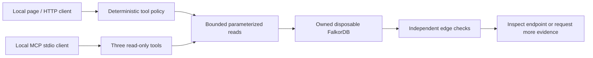

# Vesper Track 1 architecture

Vesper's submission path is a separate synthetic graph adapter. The saved live-gate results are in `evidence/track1/gate1_status.json` through `gate4_status.json`.

The graph contains `Transaction` nodes connected by directed `FLOWS_TO` relationships. Node properties are `txId`, `label`, `timeStep`, and `sourceDataset`; relationships have no properties. The saved readback reports 4,000 nodes and 6,685 edges in `vesper_synthetic_verify` with zero writes (`evidence/track1/clean-readback.txt`).

The deterministic policy performs a lookup, bounded expansion, and independent edge rereads before selecting an action. A supplied destination selects the bounded shortest-path tool. Saved tool-selection and comparison results are in `evidence/track1/gate3_selection.json` and `evidence/track1/gate3_networkx.json`.

The MCP server exposes three bounded, read-only tools over stdio: `get_transaction`, `expand_outgoing`, and `shortest_path`. The real client exchange is saved in `evidence/track1/gate4_tool_list.json` and `evidence/track1/gate4_results.json`. No claim is made about LLM-driven selection or an external chat host.

Database errors fail closed: no path or conclusion is returned as evidence. The stopped-database and recovery controls are saved in `evidence/track1/final_http_negative.json` and `evidence/track1/final_http_recovery.json`.
